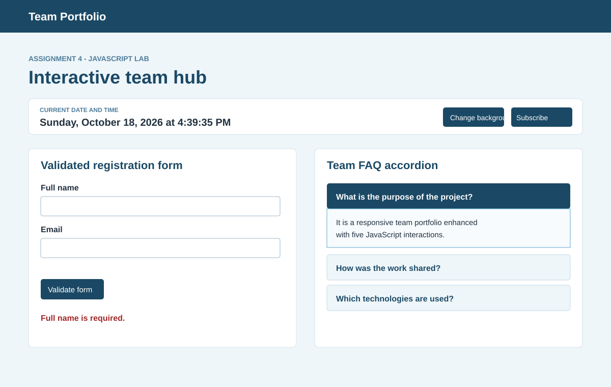
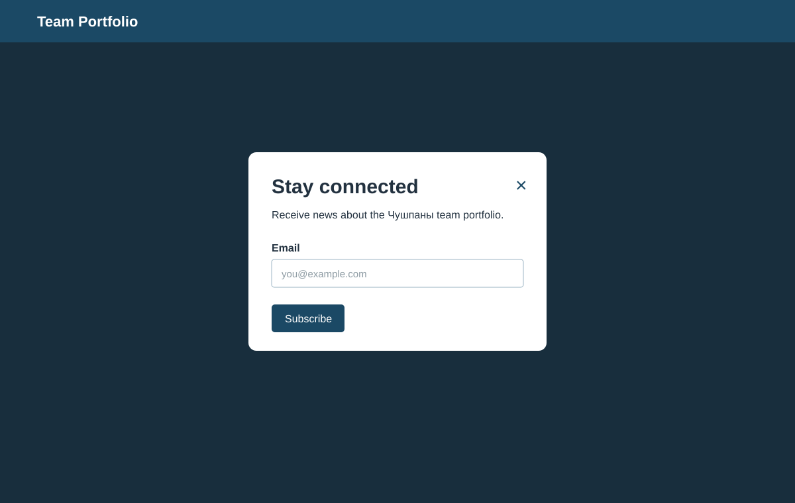

# Assignment #4 Report - Introduction to JavaScript

## 1. Team information

- **Team name:** Чушпаны
- **Members:** Ансар Амантай, Мансур Жумажанов, Ерасыл Досанкул
- **Programme:** Software Engineering, Astana IT University, Year 2
- **Repository:** https://github.com/ma1018t866/team-portfolio
- **Deployment URL:** `https://ma1018t866.github.io/team-portfolio/` (GitHub Pages target; enable Pages from the `main` branch if it is not active yet)

## 2. Objective

The existing team portfolio was extended with five interactive JavaScript components required by Assignment #4. The implementation uses one shared, dependency-free file, `js/app.js`, linked from every HTML page.

## 3. Completed tasks

### Task 1 - Form validation (15%)

The registration form on `index.html` validates required fields, email format, an eight-character minimum password, and matching password confirmation. The first clear error is displayed in an accessible live status area. A successful submission shows a confirmation message and resets the form.

**How it was achieved:** the `submit` event is intercepted in `app.js`; fields are checked with `required`, `type=email`, length logic, and an explicit password comparison. The form is tested with empty, invalid, short, mismatched, and valid data.



### Task 2 - FAQ accordion (15%)

Three FAQ questions are collapsed by default. Clicking a question toggles its answer, updates `aria-expanded`, and uses a short CSS reveal animation. The implementation also supports keyboard activation because each question is a native button.

**How it was achieved:** `app.js` attaches one click handler to every `.accordion-trigger`; the related panel is found through `aria-controls`, then its `hidden` state and visual class are toggled.

### Task 3 - Popup subscription form (10%)

The “Subscribe for updates” button opens a modal subscription form. It closes with the X button, a click on the backdrop, or the Escape key. The popup is hidden initially and includes an email input with browser validation.



### Task 4 - Change background color (5%)

The “Change background” button cycles through five accessible, low-contrast background colors. The color is updated through `document.body.style.backgroundColor` and the button receives an ARIA label describing the selected color.

### Task 5 - Current date and time (5%)

The live clock uses the JavaScript `Date` object and `Intl.DateTimeFormat`. It is formatted in a readable English format and refreshed every second.

## 4. Shared file structure

```text
team-portfolio/
├── index.html                 # Assignment 4 interaction showcase
├── contact.html
├── hobbies.html
├── member1.html
├── member2.html
├── member3.html
├── js/app.js                  # Shared JavaScript implementation
├── css/style.css              # Existing design + Assignment 4 UI styles
└── screenshots/               # Evidence images included in this report
```

All six HTML documents include `<script src="js/app.js"></script>`, and every footer contains the team name and all member names.

## 5. Verification

The project was served locally at `http://127.0.0.1:4173/index.html` and checked in a browser. The following behaviours were verified:

1. Empty form submission displays `Full name is required.`
2. Accordion opens and closes the answer while updating its expanded state.
3. Subscription popup opens over the page and has a working close control.
4. Background button changes the page color.
5. Clock renders the current date and time and updates once per second.
6. Existing navigation, Bootstrap components, gallery, profile pages, and responsive layout remain available.

## 6. Deployment and submission checklist

1. Commit the project to the shared `main` branch.
2. In GitHub, open **Settings → Pages**, select **Deploy from a branch**, choose `main` and `/ (root)`, then save.
3. Wait for the Pages workflow to finish and verify the deployment URL above on desktop and mobile widths.
4. Submit this report together with a ZIP archive of the project.

## 7. Reflection

The project demonstrates how small, reusable event handlers can turn a static portfolio into an interactive website. The main design decision was to keep all JavaScript in one shared file, which avoids duplicated logic and makes the behaviour consistent on every page. Semantic buttons, live status regions, keyboard-friendly modal closing, and readable error messages also improve accessibility and make the project easier to defend during the practice lesson.
